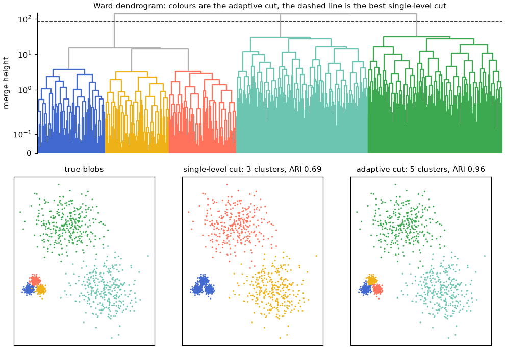
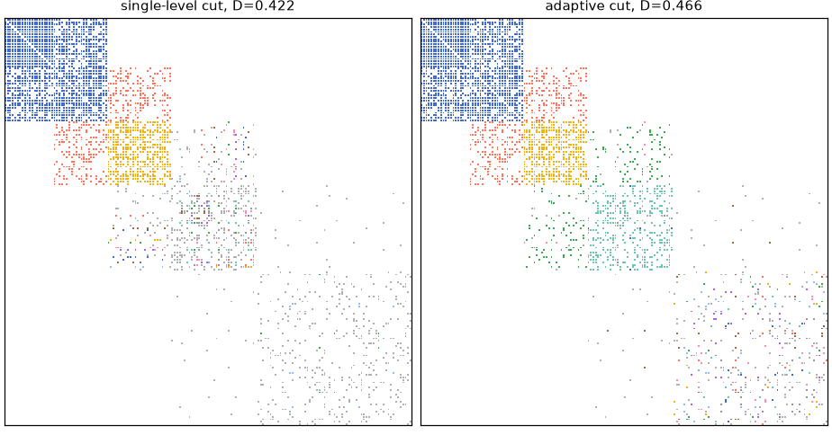
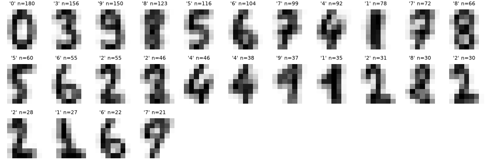

# adaptive_cut

[](https://doi.org/10.1093/pnasnexus/pgag344)
[](https://arxiv.org/abs/2512.08741)
[](https://opensource.org/licenses/MIT)
[](https://github.com/astral-sh/ruff)

Hierarchical clustering usually ends with one horizontal cut of the dendrogram,
so every cluster is taken at the same height. When clusters have different
densities or scales, no single height fits all of them.

The **adaptive cut** cuts each branch of the dendrogram at its own height. Among
all such multi-level cuts, it returns the one that maximises an objective
summed over clusters. `adaptive_cut` does this for any scipy linkage matrix:
point clouds, networks, or anything else you can build a dendrogram for.



The method is described in
L. Boucherie, Y.-Y. Ahn, S. Lehmann, *Adaptive cut reveals multiscale
complexity in networks*, PNAS Nexus (2026),
[doi:10.1093/pnasnexus/pgag344](https://doi.org/10.1093/pnasnexus/pgag344).

## Install

```bash
pip install adaptive_cut              # numpy + scipy only
pip install "adaptive_cut[numba]"     # compiled sampler, 20-50x faster
pip install "adaptive_cut[all]"       # numba + networkx
```

From a clone of the repository: `pip install -e ".[all,test]"`, then `pytest`.
The examples and the [tutorial notebook](https://github.com/LCB0B/adaptive_cut/blob/main/examples/tutorial.ipynb) also need
`pip install "adaptive_cut[examples]"` (matplotlib and scikit-learn).

## Example: clusters at different scales

The figure above comes from
[`examples/points.py`](https://github.com/LCB0B/adaptive_cut/blob/main/examples/points.py).
The data have three tight blobs next to two wide ones, clustered by Ward
linkage. Each cluster is scored by the BIC of one Gaussian fitted to it, so the
sum over a cut is the BIC of a Gaussian mixture with one component per cluster.

```python
from scipy.cluster.hierarchy import linkage
import adaptive_cut as ac
from points import blobs, gaussian_scores     # examples/points.py

X, y = blobs(seed=0)
Z = linkage(X, "ward")
scores = gaussian_scores(X, Z)                # one score per dendrogram node
level = ac.best_level_cut(Z, scores)          # 3 clusters, ARI 0.69
best = ac.optimal_cut(Z, scores)              # 5 clusters, ARI 0.96
```

A height that separates the three tight blobs also cuts the wide blobs into
pieces, so the best single-level cut (dashed line) merges the tight blobs
instead. The adaptive cut (colours) takes the tight blobs low in the tree and
the wide blobs high.

## How it works

**Cuts and scores.** Nodes follow scipy's numbering for a linkage matrix `Z`
with `n` leaves:

- leaves are `0 .. n-1`;
- row `i` of `Z` creates node `n + i`;
- the root is `2n - 2`.

A cut is a set of nodes whose subtrees partition the leaves. You give one score
per node, an array `scores` of length `2n - 1` where `scores[v]` is the value of
the cluster made of the leaves under `v`. The objective of a cut is
`scores[cut.nodes].sum()`, and it is maximised. To minimise a cost, negate it.

**Exact optimum.** Because the objective is a sum over clusters, its maximum
over all cuts follows from one bottom-up pass over the tree,
`best(v) = max(scores[v], best(left) + best(right))`. `optimal_cut` does this
in O(n) time. On ties it keeps the larger cluster.

**Single-level cut.** `best_level_cut` returns the best horizontal cut, the
usual baseline. It tries every distinct merge height and applies tied merges
together, as `fcluster(Z, h, "distance")` does.

**Sampler.** `adaptive_cut` is the Markov chain of the paper. It samples cuts
from `exp(f(cut) / T)` with a reversible-jump Metropolis-Hastings chain:

1. **Pick:** choose a current cluster uniformly at random.
2. **Direction:** leaves move up and the root moves down; any other cluster
   moves up or down with probability 1/2.
3. **Up:** merge the cluster with its sibling into their parent. If the sibling
   is itself split, all clusters below it are merged as well.
4. **Down:** replace the cluster by a sub-cut `s` of its subtree, drawn with
   probability proportional to `2^-|s|`. At least one child stays whole, so
   the move can be reversed in one step.
5. **Accept** the move with the Metropolis-Hastings ratio, which includes the
   exact proposal probabilities.
6. **Anneal:** the temperature is `T` up to step `k_sa` (default
   `2/3 n_steps`), then `T / ln(k - k_sa + 2)`.

The chain starts from the best single-level cut. It returns the best cut
visited (`res.best`), the last state (`res.final`) and a trace of the objective
(`res.trace`). Use it to explore near-optimal cuts. To get the maximum, use
`optimal_cut`: the chain can stall where improving the cut first requires a
worse one. On the blobs above, the chain at `T="auto"` stays at the
single-level cut.

- **Temperature:** `T` is in units of the objective. `T="auto"` sets it to 0.1
  times the median absolute change of the objective over the single merges of
  the dendrogram.
- **Steps:** `n_steps` defaults to `max(10_000, 10 n)`. Use 10^4 or more for a
  few thousand leaves, and 10^5 to 10^6 for larger trees.

## Your own clustering and objective

Any scipy linkage matrix and any per-cluster score work.
`node_scores(Z, func)` calls `func(leaf_ids)` on every node and returns the
`scores` array.

```python
from scipy.cluster.hierarchy import linkage
import adaptive_cut as ac

Z = linkage(X, "average")                        # any scipy dendrogram
scores = ac.node_scores(Z, my_cluster_score)     # my_cluster_score(leaf_ids) -> float
level = ac.best_level_cut(Z, scores)             # best horizontal cut
best = ac.optimal_cut(Z, scores)                 # adaptive cut, exact
res = ac.adaptive_cut(Z, scores, T="auto", rng=0)  # adaptive cut, sampled

best.value, best.n_clusters, best.labels
```

`node_scores` calls `func` once per node, so its cost grows with the sum of all
subtree sizes. For large trees, compute the scores bottom-up, as
`gaussian_scores` in `examples/points.py` does from per-node counts, sums and
sums of squares.
[`examples/any_dendrogram.py`](https://github.com/LCB0B/adaptive_cut/blob/main/examples/any_dendrogram.py)
clusters the nodes of a network by average linkage on shortest-path distances,
with modularity as the objective.

## Networks: link communities

`link_communities` runs the whole pipeline for a network. It clusters the
edges by the Jaccard similarity of their endpoints' neighbourhoods (single
linkage), scores every cluster by partition density, and returns the best
single-level cut and the adaptive cut.

```python
import numpy as np
import adaptive_cut as ac

edges = np.loadtxt("network.txt", dtype=int)   # one "u v" pair per line
r = ac.link_communities(edges, rng=0)

r.level_cut.value       # partition density D of the best single-level cut
r.partition_density     # D of the adaptive cut
r.cut.labels            # community of every edge (edge i is r.edges[i])
r.communities()         # node labels of every (overlapping) link community
r.memberships()         # sparse (nodes x communities) fraction of each node's edges
r.Z, r.scores           # the edge dendrogram and its scores, for optimal_cut etc.
```

`graph` can be an edge array of any sortable labels, a `networkx.Graph`, or a
symmetric `scipy.sparse` adjacency matrix. For weighted networks pass
`weights=` with an edge array, or `weighted=True` with a graph or matrix.
Here `T="auto"` is `clip(0.1/M * f_D, 1e-8, 1e-3)` for `M` edges, with
`f_D = 0.3` when the single-level `D > 0.7`, `0.01` when `D < 0.01`, else 1.

[`examples/sbm.py`](https://github.com/LCB0B/adaptive_cut/blob/main/examples/sbm.py)
builds two stochastic block models with five blocks each:

- **Varying density:** block densities run from 1 down to 0.1, and sparser
  blocks are larger.
- **Balanced:** five equal blocks with density 0.9 inside and 0.1 between.

```python
import numpy as np
import adaptive_cut as ac

def sbm(sizes, P, seed):
    rng = np.random.default_rng(seed)
    block = np.repeat(np.arange(len(sizes)), sizes)
    i, j = np.triu_indices(len(block), 1)
    keep = rng.random(i.size) < np.asarray(P)[block[i], block[j]]
    return np.column_stack([i[keep], j[keep]])

p = np.linspace(1, 0.1, 5)
P = np.diag(p)
for c in range(4):
    P[c, c + 1] = P[c + 1, c] = p[c + 1] ** 2
varying = sbm((20 / np.sqrt(p)).astype(int), P, seed=0)
balanced = sbm([40] * 5, 0.1 + 0.8 * np.eye(5), seed=0)

for name, edges in [("varying density", varying), ("balanced", balanced)]:
    r = ac.link_communities(edges, n_steps=50_000, rng=0)
    print(f"{name:>16}: M={len(r.edges):5d}  B={r.balancedness:.2f}  "
          f"D single-level={r.level_cut.value:.3f} ({r.level_cut.n_clusters} communities)  "
          f"D adaptive={r.partition_density:.3f} ({r.cut.n_clusters} communities)")
```

```
 varying density: M= 1550  B=0.26  D single-level=0.422 (386 communities)  D adaptive=0.466 (152 communities)
        balanced: M= 5105  B=0.66  D single-level=0.618 (16 communities)  D adaptive=0.619 (14 communities)
```

In the varying-density network, dense blocks merge low in the edge dendrogram
and sparse blocks merge high, so no single height suits every block. The
adaptive cut raises the partition density from 0.422 to 0.466. In the balanced
network all blocks merge at similar heights, and the single-level cut is
already as good as the adaptive one.

Each edge of the varying-density network, coloured by its link community
(communities of one or two edges in grey). The single-level cut that suits the
dense blocks leaves the fourth block in fragments; the adaptive cut groups it.



## Classic datasets

The Gaussian score with Ward linkage, on iris and wine (standardised) and
digits (reduced to 10 PCA dimensions). The adaptive cut raises the objective,
but the agreement with the true classes (ARI) changes little, in both
directions. The objective is not the class labels. For digits the change
depends on the preprocessing: from -0.02 to +0.11 ARI with 5 to 30 PCA
dimensions.

| Dataset | Points | B | Single-level cut | Adaptive cut |
|---|---:|---:|---|---|
| iris | 150 | 0.94 | 4 clusters, ARI 0.59 | 5 clusters, ARI 0.57 |
| wine | 178 | 0.94 | 3 clusters, ARI 0.79 | 3 clusters, ARI 0.79 |
| digits | 1,797 | 0.97 | 29 clusters, ARI 0.47 | 26 clusters, ARI 0.58 |

Mean image of each digits cluster of the adaptive cut, with its most common
digit and its size:



## Balancedness

`balancedness(Z)` describes how evenly a dendrogram splits its leaves, level by
level. Every distinct merge height of `Z` defines a level: the partition
obtained by applying all merges up to that height, with tied merges applied
together. Each level splits the `n` leaves into `k` clusters, and is compared
with two reference splits:

- `H` is the Shannon entropy (base 2) of the cluster sizes;
- `H_max` is the entropy of the most even split of `n` into `k` clusters;
- `H_min` is the entropy of the most skewed split (`k - 1` singletons).

Then

```
B = mean over levels of (H - H_min) / (H_max - H_min)
```

The mean runs over all levels where `H_max > H_min`, that is `2 <= k <= n - 2`.

- `B = 1` when every level is as even as possible.
- `B = 0` for a caterpillar dendrogram, where each merge adds a single leaf.
- `B` is `nan` when no level is informative.

`balancedness(Z, return_levels=True)` also returns the per-level values.

## Performance and reproducibility

- **Exact optimum:** `optimal_cut` is one pass over the `n - 1` merges.
- **Sampler:** each step costs O(1) plus the size of the proposed move. The
  state lives in flat integer arrays, and the proposal tables are precomputed
  once per tree.
- **Engines:** with numba installed the compiled sampler is used
  (`engine="auto"`). The pure-Python engine runs the same code. Both engines
  give identical results for the same `rng`, which CI checks on Linux, macOS
  and Windows.
- **Link clustering:**
  - The similarities come from one sparse matrix product.
  - The dendrogram comes from scipy's minimum spanning tree over the edge
    pairs. A dense `scipy.cluster.hierarchy.linkage` call would need memory
    quadratic in the number of edges.
  - Memory grows with the number of edge pairs that share a node,
    `sum_v deg(v)(deg(v)-1)/2`, so hubs dominate.

Measured on one core (numpy 2.4, scipy 1.17, numba 0.68). "Dendrogram" is
`link_communities(..., adaptive=False)`: similarities, linkage, scores,
balancedness and the single-level cut.

| Network | Edges | Edge pairs | Dendrogram | Sampler, numba | Sampler, Python |
|---|---:|---:|---:|---:|---:|
| Zachary karate club | 78 | 528 | < 0.01 s | 0.13 µs/step | 4 µs/step |
| euroroad | 1,305 | 2.7k | 0.02 s | 0.24 µs/step | 9 µs/step |
| bible_nouns | 9,059 | 368k | 0.26 s | 5.3 µs/step | 240 µs/step |
| us_roads-VT | 104,644 | 157k | 0.85 s | 6.6 µs/step | 130 µs/step |
| marvel_universe | 95,445 | 12.8M | 9.3 s | 24 µs/step | 540 µs/step |

The cost of a step grows with the number of clusters a move touches, so
networks with many small clusters under large ones are slower per step.

## API

| Function | Purpose |
|---|---|
| `optimal_cut(Z, scores)` | Adaptive cut, exact; returns `Cut` |
| `adaptive_cut(Z, scores, T, ...)` | Adaptive cut by MCMC; returns `AdaptiveCutResult` |
| `best_level_cut(Z, scores)` | Best single-level cut; returns `Cut` |
| `node_scores(Z, func)` | Per-node scores from a per-cluster function |
| `link_communities(graph, ...)` | Link clustering of a network; returns `LinkCommunities` |
| `partition_density_scores(Z, edges)` | Per-node partition density of an edge dendrogram |
| `balancedness(Z, return_levels=False)` | Balancedness of a dendrogram |

## Citation

```bibtex
@article{boucherie2026adaptive,
  title   = {Adaptive cut reveals multiscale complexity in networks},
  author  = {Boucherie, Louis and Ahn, Yong-Yeol and Lehmann, Sune},
  journal = {PNAS Nexus},
  year    = {2026},
  doi     = {10.1093/pnasnexus/pgag344}
}
```

## License

MIT
